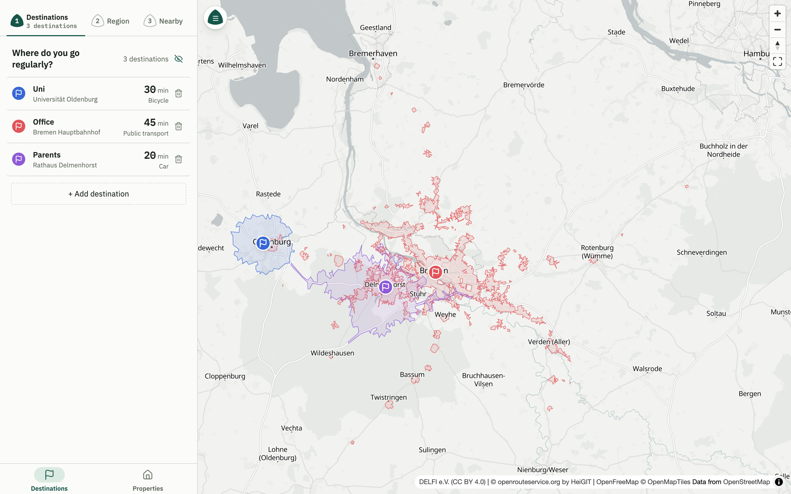
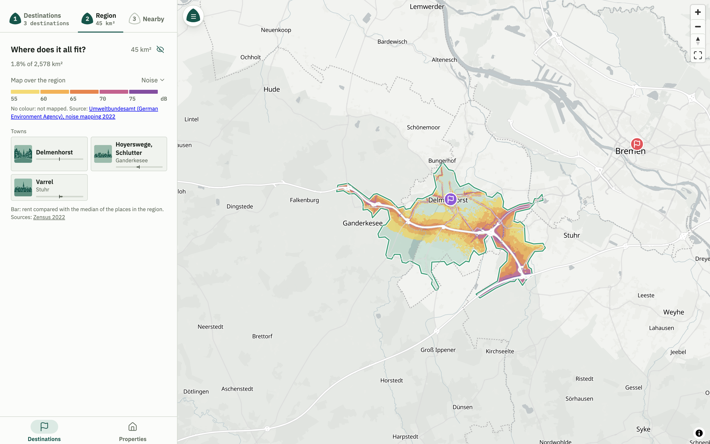
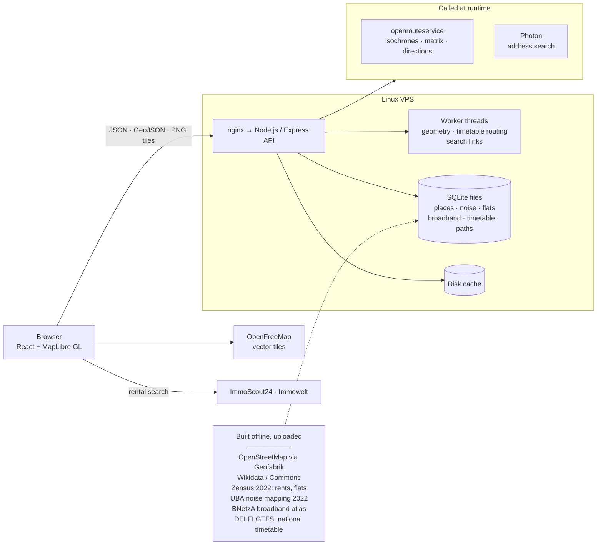
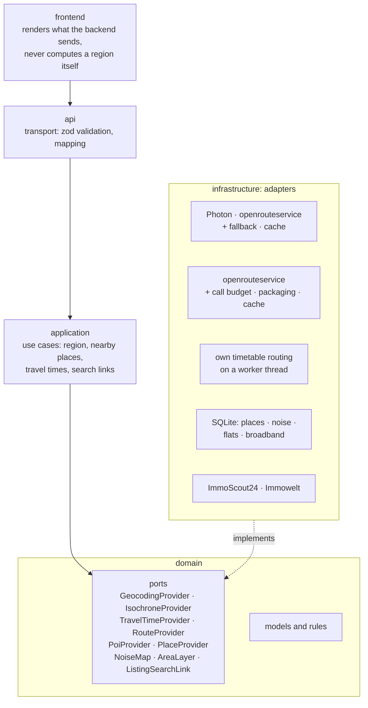
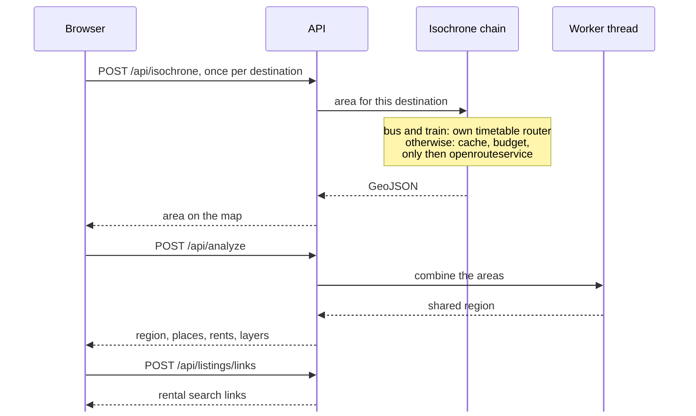

# Where We Stay

Flat listings tell you how far a place is from the city centre. That is rarely the distance that matters. What you actually want to know is whether you can still get to work, to your family and to the things you do every week without spending half the day on the road, and with two people and a few fixed places that question gets hard to answer on a map.

Where We Stay answers it. It is live at [wherewestay.de](https://wherewestay.de), and I build and run it on my own. The code itself is private, so this repository is the tour: what the app does, how it is put together, and three files taken straight out of the codebase.

## What it does

You start with the places you go to regularly, and for each one you say how you get there and how long you are willing to travel. Thirty minutes by bike to the university, forty-five by bus and train to the office, twenty by car to your parents. The app turns each of those into the area from which that place can really be reached in time. These shapes look nothing like circles. They stretch out along motorways, stop at rivers without a bridge, and for public transport they break up into small islands around the stations.

Where all of them overlap is where you could live. The app lists the towns and villages in that region, shows how their rents compare, and can lay the national noise map or broadband coverage over it. If you also need a supermarket, a school or a doctor close by, you add that as a wish and the region shrinks to the parts that have one within reach. At the end the region becomes a rental search on ImmoScout24 or Immowelt, and any address you find there can be checked against every trip at once.

## Architecture

### Where the data comes from

Most of what the app knows does not come from an API at all. Places, rents, noise levels, broadband coverage and the national bus and train timetable are built on my machine from open data, packed into SQLite files and uploaded to the server. That keeps the app fast, and it keeps working when a public service has a bad day. At runtime it only reaches out for road routing, address search and the map tiles.

### Ports and adapters

The backend has a hexagonal layout. The domain describes what it needs from the outside world as ports, the application layer only ever talks to those, and every external service sits behind an adapter in the infrastructure layer. In practice that meant switching to a different geocoder was one line in the composition root and one word in the config file.

The part of this design I like most is that adapters can wrap each other. A request for an isochrone passes through a small chain of them. The first one looks at the mode of transport and hands bus and train over to my own timetable router. The next one remembers which travel times it has already fetched for a place. The last one keeps count of how many calls to openrouteservice are left this minute and today. Only after that does anything leave the server, and none of the three knows the others exist.

### One request, end to end

This is what happens between typing in the first address and opening a rental search.

## A few things worth mentioning

The first version asked a public API for supermarkets, schools and the like every time someone added a wish. For a single town that could take more than half a minute. Today around 650,000 places in Germany and its neighbouring countries are pulled out of OpenStreetMap once a month into a local database, and the same question is answered in milliseconds.

Bus and train travel times do not come from an external service either. The app reads the national GTFS timetable published by DELFI and works them out itself, on its own worker thread, so a long search does not hold up anyone else's request. Combining the areas and building the search links run on worker threads as well.

The free tier of openrouteservice allows 20 isochrones a minute and a fixed number per day, and a lot of the backend is shaped around that. Every call reserves its slot before it goes out, so a burst of parallel requests cannot all read the same counter and overshoot. One request can carry up to five places and several travel times and still counts as a single call, and whatever comes back lands in a disk cache. Most of the time the limits never come up.

Sharing a plan stores nothing on the server. The whole plan is compressed into the part of the link after the `#`, which browsers never send anywhere, so nobody's home or work address ends up in a server log.

There are also a little over 900 tests, covering the domain rules, the adapters, the API and the UI.

## Code samples

These three files are copied unchanged, German comments included. I use comments to explain why something is the way it is, often with the measurement that settled it.

[`isochrone-provider.ts`](samples/isochrone-provider.ts) is one of the domain ports. Every method says why it exists. The batch methods, for example, are only there because the provider counts five places in one request as a single call.

[`fallback-geocoder.ts`](samples/fallback-geocoder.ts) is a small decorator that asks a second geocoder when the first one could not answer. It deliberately does not do that when the first one answered with "nothing found", because the second one then tends to return the middle of the street instead, up to 1.5 km away from the actual address.

[`call-budget.ts`](samples/call-budget.ts) is the rate limiter described above. It works with sliding windows, so it can never let more through than the provider allows.

## Stack

TypeScript throughout · React, Vite, MapLibre GL · Node.js, Express, zod · SQLite · Turf.js / polygon-clipping · Vitest · deployed to a Linux VPS

## How it was built

I built Where We Stay with Claude Code. I decided the architecture, wrote the specification and judged what was good enough. Claude Code wrote the code. Every decision we made along the way, and the reason behind it, is written down in the project's own guide, which by now is longer than any source file in the repository.
