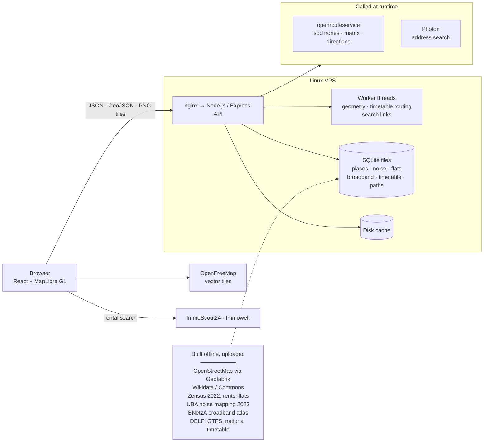
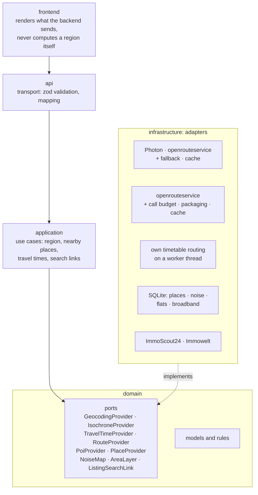
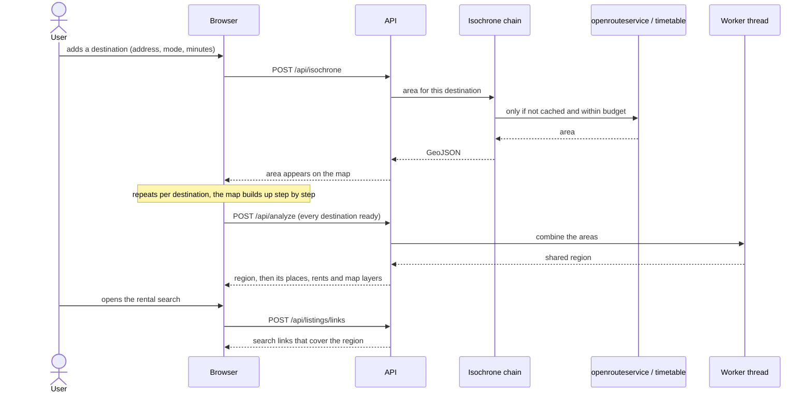

# Where We Stay

**Where can we live so that every place we go to stays within reach?**

Live at **[wherewestay.de](https://wherewestay.de)**. A solo project, built and run by one developer. The source code is private. This page shows what the app does, how it is put together and a few pieces of its code.

## What it does

Two people work in different cities, the parents live in a third, and the gym should not be an hour away. A map with circles cannot answer that: straight-line distance crosses rivers and ignores the way roads and timetables actually run.

Where We Stay works with **travel times** instead:

1. **Destinations.** Each place you go to regularly gets its own mode and limit: 30 minutes by bike to the university, 45 minutes by bus and train to the office, 20 minutes by car to the parents. Each one becomes the area from which it can be reached in time.
2. **Region.** Where all those areas overlap is where you can live. The app lists the cities, towns and villages inside it, compares their rents, and can lay noise or broadband maps over it.
3. **Nearby.** Supermarket, school, station, doctor: pick what matters, and the region narrows to where those are within reach too.
4. **Properties.** The region becomes a rental search on ImmoScout24 and Immowelt, and any address can be checked against every trip.

## Architecture

### System overview

Most of the data is built offline into SQLite files and uploaded to the server. At runtime the app only calls out for routing, geocoding and map tiles.

### Ports and adapters

The backend is hexagonal. The domain defines ports, the application layer works only through them, and every provider sits behind an adapter. Replacing a provider is one entry in the composition root and one word in the configuration.

Adapters wrap each other rather than growing flags. Isochrones, for example, are a chain: a **mode switch** sends bus and train to the own timetable router and everything else onward, a **packaging** layer stores the time steps it has already fetched, and a **call budget** keeps the app inside the provider's per-minute and per-day limits before the request reaches openrouteservice.

### One request, end to end

## Engineering highlights

- **Own place database.** Around 650,000 places across Germany from OpenStreetMap, built monthly into SQLite. A lookup that used to wait tens of seconds on a public API now answers in milliseconds.
- **Own timetable routing.** Bus and train travel times come from the national GTFS timetable, computed on a worker thread inside the app, not from a paid API.
- **Provider limits as a design input.** The free routing tier allows 20 isochrones a minute and a fixed number a day. Requests reserve a slot before they go out, bundle up to five places and several time steps into one call, and land in a disk cache, so the limits are rarely reached and never exceeded.
- **Heavy work off the request thread.** Geometry, timetable routing and search-link building run on worker threads, so one large region does not stall everyone else.
- **Privacy by construction.** A shared plan lives entirely in the part of the link after `#`, which browsers never send to a server: real addresses never reach the server log.
- **Tested.** Over 900 tests (Vitest) across domain rules, adapters, API and UI.

## Code samples

Three files copied unchanged from the codebase. The comments are in German, as in the original.

| File | What it shows |
| --- | --- |
| [`samples/isochrone-provider.ts`](samples/isochrone-provider.ts) | A domain port. Each method documents why it exists, with the measurements that decided it. |
| [`samples/fallback-geocoder.ts`](samples/fallback-geocoder.ts) | A decorator adapter. It falls back to the second provider only when the first could not answer, never when it answered "not found". |
| [`samples/call-budget.ts`](samples/call-budget.ts) | A sliding-window budget for provider calls. It reserves before the call, so parallel requests cannot overshoot the limit. |

## Stack

TypeScript throughout · React, Vite, MapLibre GL · Node.js, Express, zod · SQLite · Turf.js / polygon-clipping · Vitest · deployed to a Linux VPS

## How it was built

Built with **Claude Code**. I set the architecture, wrote the specifications and set the bar for quality; Claude Code wrote the code, with every decision and its reason recorded in the project's own guide as it went.
